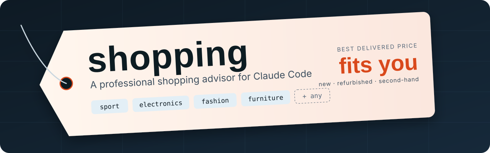
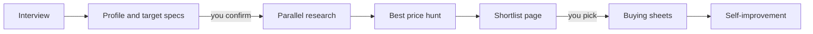
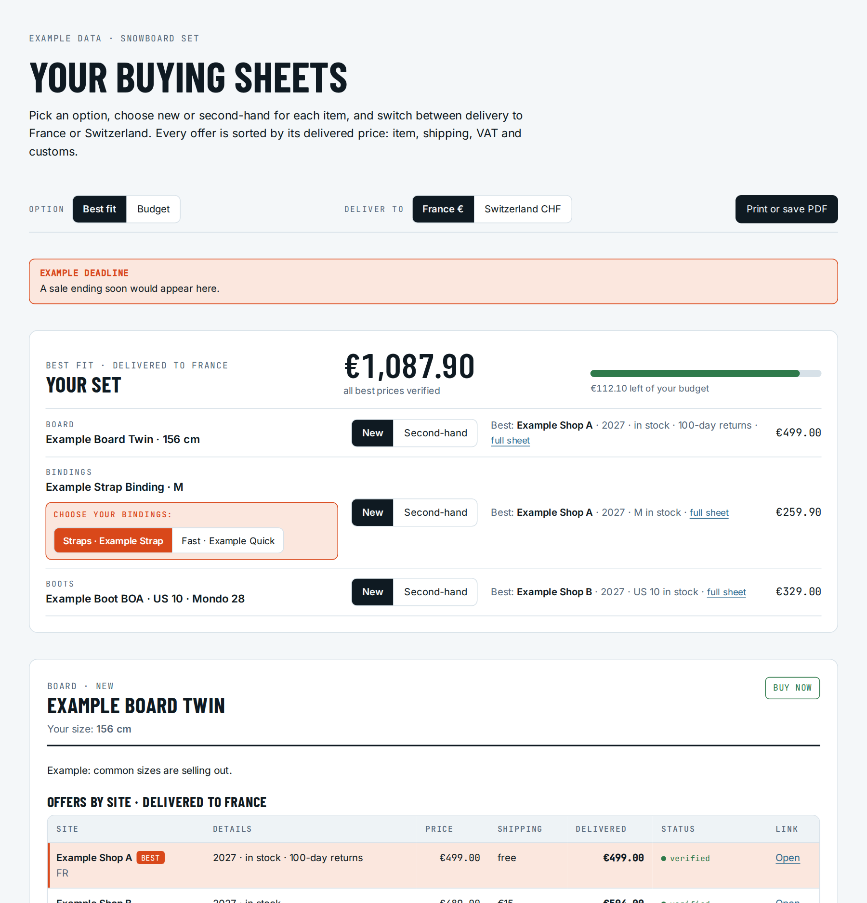

<p align="center">
  
</p>

<p align="center">
  <a href="CHANGELOG.md"></a>
  <a href="LICENSE"></a>
  <a href="https://docs.claude.com/en/docs/claude-code"></a>
  <a href="references/categories"></a>
  <a href="CONTRIBUTING.md"></a>
</p>

<p align="center">
  <b>An expert from a specialist shop, with a research team behind it, inside Claude Code.</b><br>
  It interviews you, works out what fits <i>you</i>, searches tests, forums, shops and second-hand marketplaces,<br>
  and hands you the best delivered price, ready-to-send seller messages and interactive buying sheets.
</p>

<p align="center">
  <a href="#quick-start">Quick start</a> ·
  <a href="#how-it-works">How it works</a> ·
  <a href="#categories">Categories</a> ·
  <a href="#second-hand-marketplaces">Marketplaces</a> ·
  <a href="#buying-sheets">Buying sheets</a> ·
  <a href="#faq">FAQ</a>
</p>

---

## Quick start

```bash
git clone https://github.com/Gagallllllllll/shopping-skill ~/.claude/skills/shopping
```

Restart Claude Code, then just ask:

> I need a new snowboard set for this winter, delivered to France.

> Which laptop for photo editing, around 1,200 euros?

> Is this a good deal? https://www.facebook.com/marketplace/item/...

Or type `/shopping`. Update any time with `git -C ~/.claude/skills/shopping pull`.

> [!NOTE]
> This skill was called **sport** until version 1.10.0. Sport is now one of its category packs. Old links to `sport-skill` redirect here.

---

## Why

Buying well takes hours: reading tests, decoding sizes, comparing shops, adding shipping and customs, checking second-hand listings for scams. Most "best of" lists are affiliate rankings. **shopping** does that work like a specialist would, for your profile, and shows its sources.

| | Typical buying guide | **shopping** |
|---|---|---|
| Recommendation | "best overall" | best **for you**, from a validated profile |
| Size | generic chart | brand chart, mid-range rule, conflicts explained |
| Price | list price | **delivered** price (shipping, VAT, customs), price history, discount codes checked |
| Second-hand | rarely | Leboncoin, Facebook Marketplace, Vinted, Ricardo, eBay... with scam checks |
| Sources | hidden | every claim marked *verified*, *recommendation* or *not confirmed* |

---

## How it works



| Step | What happens | What you do |
|---|---|---|
| **1. Interview** | Up to 3 short rounds of questions with suggested answers: need, use, sizes, budget, **delivery country**, marketplaces you use, search depth. | Answer, or say "ok". |
| **2. Profile** | Target specs with the reasoning. Nothing is recommended before you confirm. | Confirm or correct. |
| **3. Research** | 3 to 4 agents in parallel: independent tests, user communities, brand specs, shops. 2 independent sources per model. | Wait a few minutes. |
| **4. Best price** | Delivered price across shops (and their other country sites), comparison sites, outlets, refurbished and second-hand; price history, discount codes, **official recall check**, buy now or wait. | Wait a few minutes. |
| **5. Shortlist** | Options side by side, recommended one highlighted, comparison table, sources. | Pick an option. |
| **6. Buying sheets** | One sheet per item with every offer, seller messages, checklists. | Buy on the shop's site yourself. |

**Listing check, any time:** send a listing you found (link, screenshot or text). You get the exact model, fit and size check, wear, fair price, scam signs, a verdict, questions to ask and a message ready to send.

---

## Categories

Each category has a **pack** in [`references/categories/`](references/categories): questions that matter, rules to turn needs into specs and sizes, trusted sources, price and timing, second-hand checks, legal points and traps.

| Pack | Covers | Status |
|---|---|---|
| [`sport`](references/categories/sport.md) | sports gear for any sport | **tested** on a real purchase |
| [`electronics`](references/categories/electronics.md) | laptops, phones, tablets, TVs, audio, cameras | draft |
| [`fashion`](references/categories/fashion.md) | clothing, shoes, bags | draft |
| [`furniture`](references/categories/furniture.md) | sofas, mattresses, beds, desks, office chairs | draft |
| *any other* | the skill writes a draft pack during the session | draft |

*Draft* packs were built from sourced research and mark every fact as verified or not confirmed; they become *tested* after real use. **Sensitive categories** (medicines and supplements, medical devices, child car seats, weapons, financial products) get general information and official sources only.

---

## Second-hand marketplaces

Local marketplaces often have the best finds. The skill never logs in or creates accounts.

| Marketplace | How the skill uses it | Tool |
|---|---|---|
| **Facebook Marketplace** | searches by city and keyword through the public search page (no account) and reads listing links you send | `marketplace_search.py`, `listing_preview.py` |
| **Leboncoin** | searches ads (optional add-on) | `leboncoin_search.py` |
| **Vinted, eBay, Ricardo, tutti, anibis, Kleinanzeigen, Subito, Wallapop, Marktplaats...** | reads search pages and listings, or gives you filtered search links and alerts to set | `shop_fetch.py`, `listing_preview.py` |

Details and search link patterns: [`references/core/marketplaces.md`](references/core/marketplaces.md).

---

## Buying sheets

<p align="center">
  
  <br><sub>Screenshot with example data (placeholder shops and prices).</sub>
</p>

| Feature | What it does |
|---|---|
| **Option picker** | Switch between the shortlist options; a **Your picks** option tracks the exact listings you choose. |
| **Delivery country switch** | For example *France €* / *Switzerland CHF*: totals and the order of offers follow. |
| **Model switch** | Compare alternatives inside a set (for example strap or quick-entry bindings). |
| **New / Second-hand per item** | Mix freely; the set total updates live against your budget. |
| **One sheet per item** | Every offer sorted by delivered price. Offers with an unconfirmed size, and brand list prices, never count as best. |
| **Buy now or wait · Specs and size · Checklist** | Per item, for new or second-hand. |
| **Print or save PDF** | One clean sheet per page. |

The page is built from [`templates/buying-sheets.html`](templates/buying-sheets.html), a single HTML file with no install. Fill its `DATA` object to make your own:

<details>
<summary><b>DATA field reference</b></summary>

```js
const DATA = {
  budgetEUR: 1200,                       // budget shown in the first country view
  items: {
    board: {                             // one entry per item; the key is any short id
      kind: "Board",                     // category shown above the name
      short: "Straps · Brand Model",     // optional: label on the model switch
      name: "Brand Model",
      size: "156 cm",                    // the size or variant recommended
      specs: ["True twin", "Flex 5/10"], // short chips
      fit: "Why this size and model fit.",
      advice: {
        now:  ["now",  "Reason to buy new now"],      // "now", "wait" or "na" (not available)
        used: ["wait", "Reason about second-hand"]
      },
      offers: [
        { c: "new",                     // "new" or "used"
          site: "Shop name", ctry: "FR",
          note: "2027 · in stock · 100-day returns",
          price: "€548.90",              // price as shown on the site (text)
          ship: "free",                  // shipping as shown (text)
          fr: 548.90,                    // delivered total for country 1 (€), or null
          ch: 504.69,                    // delivered total for country 2 (CHF), or null
          chNote: "CHF 30 delivery with customs",   // optional note for country 2
          st: "v",                       // "v" verified, "n" not confirmed
          stCh: "n",                     // optional: different status for country 2
          out: false,                    // true = out of stock (greyed, never "best")
          sizeOk: true,                  // false = size not confirmed (never "best")
          ref: false,                    // true = brand list price, not a shop offer
          url: "https://..." }
      ]
    }
  },
  options: [
    { id: "best", label: "Best fit",
      items: ["board", ["bindingsA", "bindingsB"]],   // an array = alternative models, shown as a switch
      def: { board: "new", bindingsA: "new", bindingsB: "new" } }   // default New / Second-hand per item
  ],
  checks: {
    new:  ["Size in stock on the product page"],
    used: ["Pay only inside the platform"]
  }
};
```

**Other countries:** rename the two switch buttons (`data-c="fr"`, `data-c="ch"`) and use the same keys in each offer. **Deadlines and blocked sites:** edit the `deadlines` section and the last footer line.

</details>

---

## Search depth

You choose how deep the research goes:

| Depth | Research agent | Deals agent | Second-hand | Best for |
|---|---|---|---|---|
| **Quick** | 12 tool calls | 15 | top 2 sites | small purchase, in a hurry |
| **Standard** (default) | 20 | 25 | main sites | most purchases |
| **Deep** | 40 | 50 | every site, extra pass per item | expensive or rare items |

Agents stop early once they have enough and run on a lighter model (Sonnet). If a budget runs out you get partial results, what is missing, and the option to extend for just that gap.

---

## Optional add-ons

Everything works without them; they give access to sites that block simple reading.

| Add-on | Install | Gives | Know before you install |
|---|---|---|---|
| [Scrapling](https://github.com/D4Vinci/Scrapling) 0.5.1 (BSD-3) | `scripts/setup-scrapling.sh` | reads protected shops (eBay, idealo, Ricardo...) and renders Facebook Marketplace search | some sites forbid automated reading in their terms |
| [Obscura](https://github.com/h4ckf0r0day/obscura) 0.2.7 (Apache-2.0, non-stealth build, checksum verified) | `scripts/setup-obscura.sh` | fast parallel first pass (about 7× faster on 8 shop pages); blocked pages fall back to Scrapling automatically | young project, prebuilt binary |
| [lbc](https://github.com/etienne-hd/lbc) 1.1.9 (MIT) | `scripts/setup-leboncoin.sh` | Leboncoin search | imitates the Leboncoin app to pass its robot protection: against Leboncoin's terms, your connection can be blocked for a while |

All add-ons are pinned, run in their own folder, and are used with built-in limits: a few pages or searches per run, pauses, no login, no proxy, no paid bypass service.

---

## It improves itself

After each session the skill notes what worked and what did not. Real lessons go into [`LESSONS.md`](LESSONS.md); category knowledge goes into the pack, method fixes into [`references/core/`](references/core). The version goes up in [`CHANGELOG.md`](CHANGELOG.md) and the change is published here. Lessons are always generic: never a name, a size, a place or a budget.

---

## Repository layout

```
SKILL.md                          the method and rules
references/core/                  interview, research, deals, marketplaces, report design (all categories)
references/categories/            category packs: sport, electronics, fashion, furniture
templates/buying-sheets.html      interactive buying sheets (fill the DATA object)
scripts/listing_preview.py        reads a listing link's public preview (no login, standard library)
scripts/marketplace_search.py     Facebook Marketplace search by city and keyword
scripts/shop_fetch.py             reads protected shop pages (Obscura first, Scrapling fallback)
scripts/leboncoin_search.py       Leboncoin search (optional lbc)
scripts/setup-*.sh                optional add-on installers (pinned)
assets/                           banner and screenshot
LESSONS.md · CHANGELOG.md         what real use taught the skill · version history
```

---

## Safety and privacy

- It **never buys anything**, logs in, creates accounts, subscribes or fills in forms. It gives links; you buy.
- It never asks for card or bank details, and never for your passwords.
- Your measurements and personal details stay in your conversation, never in this repo.
- Health, injuries, safety-critical and financial questions: general information only, with a referral to a professional.
- Legal points (returns, guarantees) are re-checked on official pages; the skill says when it could not.
- Web pages and listings are treated as data, never as instructions.

See also [SECURITY.md](SECURITY.md).

---

## FAQ

<details><summary><b>Does it work outside France and Switzerland?</b></summary>
Yes. It asks your delivery country and searches shops and marketplaces for it. The buying sheets compare two delivery countries; rename the switch for yours.
</details>

<details><summary><b>What if my category has no pack?</b></summary>
It uses the core method and writes a draft pack during the session.
</details>

<details><summary><b>How long does a session take?</b></summary>
A few minutes of questions, then several minutes of research running in parallel, within the search depth you chose.
</details>

<details><summary><b>Are discount codes guaranteed?</b></summary>
No. A code is <i>verified</i> only if the shop's own site shows it; codes from coupon sites are <i>not confirmed</i>.
</details>

<details><summary><b>Why is a cheap listing not ranked first?</b></summary>
Ranking uses the delivered price and a confirmed size. A listing that looks cheaper can cost more once shipping and import charges are added.
</details>

<details><summary><b>Can I use it without Claude Code?</b></summary>
The buying sheets template works in any browser. The interview, research and price hunt need Claude Code.
</details>

---

## Contributing

Contributions are welcome, especially from real purchases: a bad recommendation, a missing question, a weak source, a new category pack. See [CONTRIBUTING.md](CONTRIBUTING.md) and use the [issue templates](.github/ISSUE_TEMPLATE). Remove personal data before posting.

## License

[MIT](LICENSE) © 2026 Gagallllllllll
